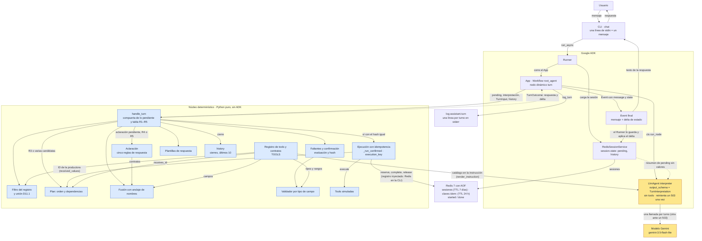
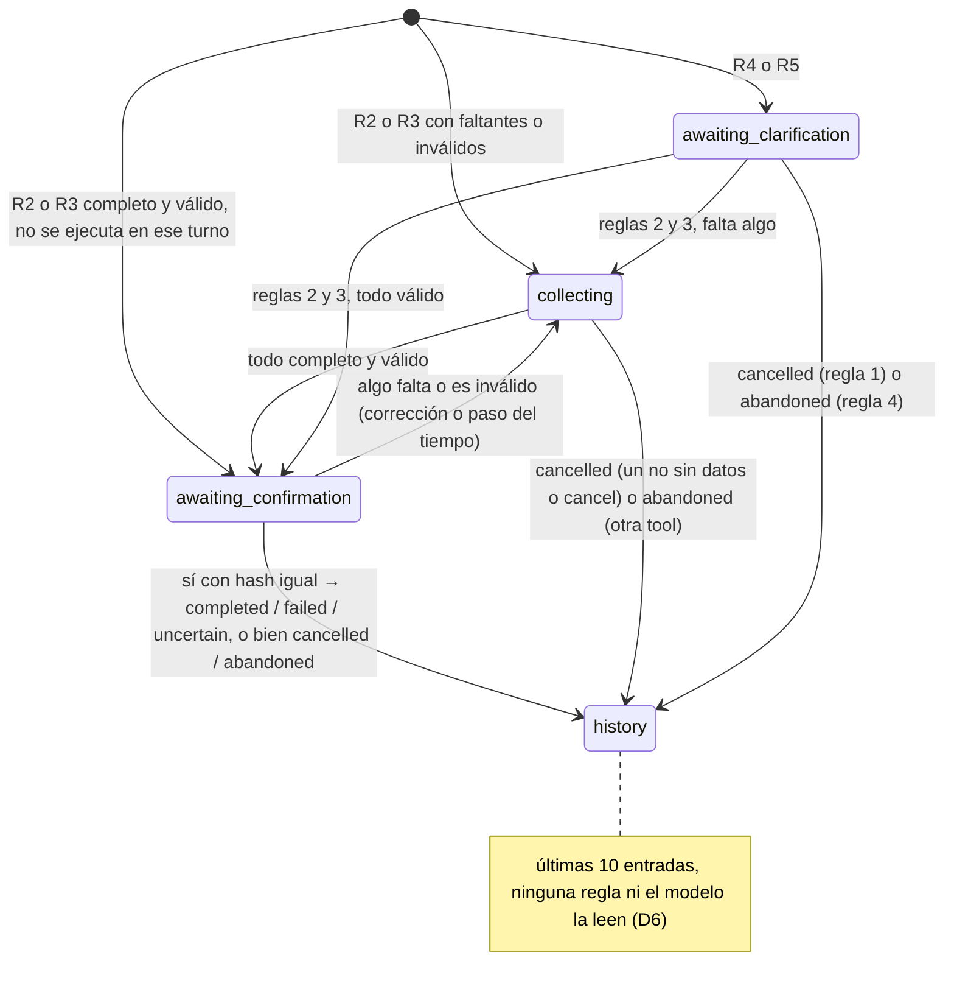

# Arquitectura

Un solo agente de Google ADK cuyo LLM **solo interpreta** el mensaje y llena un esquema fijo
(`TurnInterpretation`). Todo lo demás es código en Python puro (`core/`, sin ADK) que el nodo del
turno llama una vez por mensaje: decide, valida, pregunta, confirma, ejecuta y devuelve el cambio
de estado (D1, D1.1). Cada caja de la figura 1 tiene su archivo y su símbolo en la tabla que sigue.

## Figura 1 · Componentes

Amarillo: el modelo. Azul: el núcleo, que no importa ADK ni llama al modelo; solo `_run_confirmed`
llama a una tool (D46). Sin color: piezas de ADK (la biblioteca), la CLI e infraestructura.

### Correspondencia con el código

| Nodo | Archivo | Símbolo | Qué es |
|---|---|---|---|
| `cli` | `assistant/cli.py` | `chat` | Lee stdin, manda cada línea al `Runner` e imprime las respuestas que no son del intérprete. |
| `runner` | `assistant/cli.py` | `Runner` | ADK: recibe un mensaje, carga la sesión, corre el agente y guarda cada `Event` en la sesión. |
| `sessions` | `assistant/cli.py` | `RedisSessionService` | ADK: guarda sesiones y su `session.state` en Redis, así una sesión sigue en otro proceso. |
| `turnNode` | `assistant/agent.py` | `build_root_agent` | ADK: `App` con un `Workflow` (`root_agent`) de un solo nodo, `turn`, que hospeda el turno (D1.1). |
| `interp` | `assistant/interpreter.py` | `build_interpreter` | ADK: `LlmAgent` sin tools que devuelve JSON validado contra el esquema; su modelo reintenta un 503 una vez (`INTERPRETER_RETRY_OPTIONS`, D1.2). |
| `finalEvent` | `assistant/agent.py` | `Event` | ADK: el único evento que escribe estado; su `state` pasa a `actions.state_delta` (D1.1). |
| `registry` | `core/registry.py` | `TOOLS` | Un `ToolSpec` por tool: campos, contrato Pydantic, mock y `receives_id`. |
| `handleTurn` | `core/turn.py` | `handle_turn` | Decide el turno: compuerta (`_pending_gate`, `_confirm`) y tabla R1–R5 (`_rules_table`) (D3). |
| `filterOps` | `core/operations.py` | `filter_by_registry` | Quita tools desconocidas y campos ajenos al contrato (D10); `join_split_operations` (D11.1). |
| `clarif` | `core/clarification.py` | `answer_rule` | Guarda las candidatas de R4 y R5 y lee la respuesta con cinco reglas (D3). |
| `plan` | `core/plan.py` | `plan_order` | Ordena los pasos e infiere la dependencia del registro (D8.1, D8.4); al ejecutar, `received_values` da al paso receptor el ID de su productora (D8.2). |
| `merge` | `core/merge.py` | `merge_args` | Ancla cada nombre al mensaje y fusiona con lo guardado (D4). |
| `validator` | `core/validation.py` | `validate` | Valida y normaliza por tipo de campo, fechas y horas contra `now` (D5). |
| `assess` | `core/assessment.py` | `assessment` | `collecting` con una pregunta, o `awaiting_confirmation` con `confirmation_hash` (D7). |
| `run` | `core/executions.py` | `execution_key` | Clave de idempotencia por paso; `_run_confirmed` (en `core/turn.py`) reserva, ejecuta y corta (D9). El registro de ejecuciones llega inyectado (`Executions`): Redis en la CLI, memoria en los tests. |
| `mocks` | `core/mock_tools.py` | `create_ticket` | Las tres tools simuladas; cada una pasa sus argumentos por su contrato. |
| `replies` | `core/replies.py` | `step_line` | Toda respuesta sale de plantillas: el modelo nunca redacta la respuesta, y los valores que extrajo solo aparecen dentro de ellas, para que el usuario los confirme. |
| `hist` | `core/history.py` | `closed_entry` | Entrada `{operation_id, status, steps}` de cada operación cerrada (D6). |
| `redis` | `docker-compose.yml` | `appendonly` | Redis 7 con AOF; las claves `idem:` las escribe `RedisExecutions` (`assistant/executions.py`). |
| `log` | `assistant/agent.py` | `log_turn` | Una línea `clave=valor` por turno: acto, ruta, cambios, resultados, claves. |

## Figura 2 · Estados de `pending`

Un turno sin cambios, o una corrección que sigue válida (hash nuevo, D47), no cambia de estado;
tras `abandoned`, el flujo nuevo empieza en el mismo turno desde `[*]`, sin heredar nada (D3.1).

## Ciclo de un turno

1. `chat` manda la línea al `Runner` (`run_async`), que carga la sesión y corre el `App`.
2. El nodo `turn` lee `pending` (solo lectura) y llama al intérprete con `ctx.run_node`; este ve el
   mensaje actual y un resumen de `pending` sin valores, y ADK valida su salida.
3. Si el modelo falla (salida vacía, esquema inválido o un error; un 503 se reintenta una vez), el
   nodo responde una plantilla en un `Event` sin `state`: nada cambia (D1.1, D1.2).
4. Si no, arma `TurnInput` (texto, `now` del reloj local, id de sesión) y llama a `handle_turn`
   con `pending`, la interpretación, `history` y el registro de ejecuciones.
5. `filter_by_registry` filtra las operaciones (D10); dos de una tool piden elegir (D11, D11.1).
6. Compuerta (D3): una aclaración pendiente lee el turno con `answer_rule`; con algo pendiente, un
   `confirm` va a `_confirm` y el resto a `_pending_gate`; sin nada pendiente, una solicitud va a
   `_rules_table` (R1–R5), y un plan se ordena con `plan_order`.
7. `merge_args` ancla y fusiona, `validate` valida contra `now` y `assessment` da `collecting` con
   una pregunta o `awaiting_confirmation` con los valores y su hash. Ese turno no ejecuta (D7.1).
8. Un «sí» a `awaiting_confirmation`, sin otra tool ni cambios y con el hash igual, llega a
   `_run_confirmed`: los pasos en orden, cada uno bajo su `execution_key`, el ID del ticket al
   final del `message` de la notificación, y corte en el primer paso no hecho (D8, D9).
9. Cada cierre vacía `pending` y añade su entrada a `history` (`closed_entry`).
10. El nodo escribe `log_turn` y devuelve un solo `Event` con la respuesta (plantillas de
    `core/replies.py`) y el delta; el `Runner` lo guarda en Redis y `chat` imprime el texto.

## Qué decide el LLM y qué el código

| Tema | LLM (solo campos de `TurnInterpretation`) | Código determinístico |
|---|---|---|
| Acto del mensaje | `act`, uno de siete valores | Qué hacer con él según lo pendiente: `_pending_gate`, `_confirm` (D3) |
| Tools pedidas | `operations[].tool` | `filter_by_registry` descarta lo que no está en `TOOLS` (D10) |
| Certeza | `operations[].certainty` | `_rules_table` cuenta y elige R1–R5: un flujo, un plan o aclarar (D3) |
| Argumentos | `operations[].args` tal como se dijeron; fechas y horas en partes, sin convertir | `merge_args`: anclaje de nombres y fusión con lo guardado (D4) |
| Validación y faltantes | nada | `validate` (tipo, rango, valores permitidos, fecha y hora contra `now`) y `assessment`: una pregunta por lo que falta o es inválido; nada se inventa (D4, D5) |
| Confirmación | `confirms_tool`, la tool que nombró al decir sí | `_confirm` y `confirmation_hash`: el sí vale solo para lo mostrado (D7) |
| Dependencias | `operations[].depends_on` | `plan_order` ordena, ignora ciclos e infiere por `receives_id` (D8, D8.4) |
| Ejecución | nada | `_run_confirmed`, `execution_key` y el registro de ejecuciones (D9) |
| Ambigüedad | `ambiguity_reason` | Solo va al log; ninguna regla lo lee (D2) |
| Respuesta y estado | nada | Plantillas de `core/replies.py`: el modelo nunca redacta la respuesta y sus valores extraídos solo se muestran dentro de ellas, para confirmarlos; `pending` y `history` los escribe solo el `Event` final (D1.1, D6) |

**Un solo agente:** el modelo no llama a tools ni decide la secuencia; otro agente solo sumaría
llamadas y estado que coordinar, sin justificación técnica con tres tools (D1; TASK.md 506 y 589).

## Los 11 puntos mínimos del diagrama

| Línea de TASK.md | Punto | Nodos de la figura 1 |
|---|---|---|
| 479 | Interacción con el usuario | extUser, cli |
| 481 | Agente desarrollado con ADK | runner, turnNode, interp, finalEvent |
| 483 | Identificación de intención | interp, extGemini, handleTurn |
| 485 | Selección y orquestación de herramientas | registry, filterOps, handleTurn, clarif, plan |
| 487 | Extracción de argumentos | interp, merge |
| 489 | Validación de argumentos | validator, registry |
| 491 | Manejo de información faltante | assess, replies |
| 493 | Gestión de memoria y estado conversacional | sessions, finalEvent, hist, redis |
| 495 | Ejecución de herramientas | run, mocks, redis |
| 497 | Manejo de resultados y errores | run, hist, replies, log |
| 499 | Feedback hacia el usuario | replies, finalEvent, cli, extUser |
